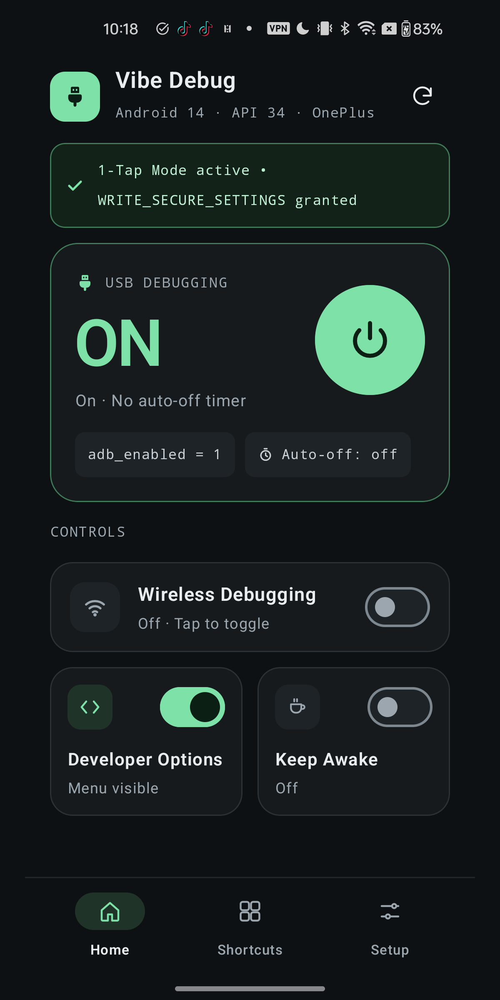
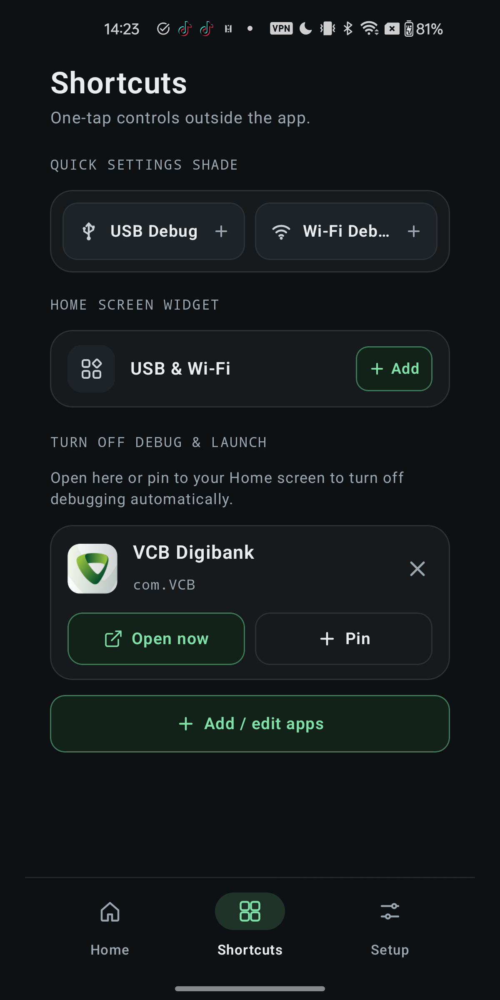
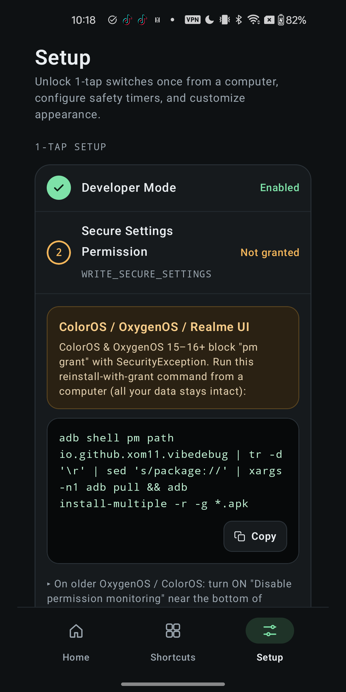
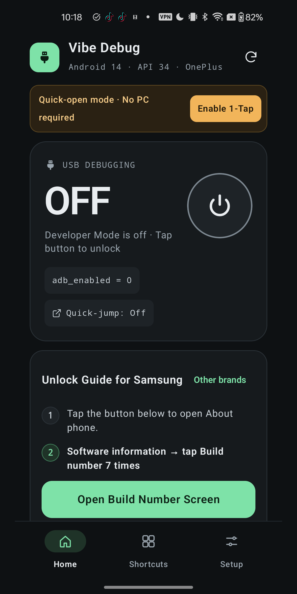

# Vibe Debug — USB Debug Switch for Android

A clean, zero-ad, zero-internet-permission Android utility (**Vibe Debug**, `io.github.xom11.vibedebug`) built for everyday users and developers to inspect and switch **USB Debugging** without digging through nested Settings menus.

  
  
  
  

## Key Capabilities

- **Zero-setup guided flow out of the box (Mode A):**
  - Detects whether Developer Mode is unlocked. If not, detects the device manufacturer (Samsung, OPPO/Realme/OnePlus, Xiaomi/Redmi/POCO, Vivo/iQOO, Google/Stock Android) and displays a focused 2-step guide matching that brand's exact menu labels, plus a button that jumps directly to **About Phone / Build Number**.
  - Once Developer Mode is unlocked, displays live status for **USB Debugging**, **Wireless Debugging** (Android 11+), **Developer Mode**, and **Keep Awake**, with an interactive Hero button that opens **Developer Options** and highlights **USB debugging** (`:settings:fragment_args_key = "enable_adb"`).
  - Surfaces a concise hint right on the **Developer Options** card to turn it off when strict apps block debugging, plus an optional Mode A quick-jump preference (OFF by default).
- **Automatic 1-tap upgrade (`WRITE_SECURE_SETTINGS`, Mode B):**
  - Once `android.permission.WRITE_SECURE_SETTINGS` is granted once via ADB or Shizuku (including the `adb install-multiple -r -g` flow for ColorOS / OxygenOS 15–16+), the app automatically upgrades into **1-Tap Mode** across the app, **2 focused Quick Settings tiles** (**USB Debug**, **Wireless Debug**), and **1 unified adaptive Home Screen widget** (**USB & Wi-Fi**) scaling cleanly across 7 size tiers (`1×1` → `2×1` → `3×1` → `4×1` → `2×2` → `4×2`).
  - Also supports automatically keeping the screen awake while USB Debugging is active (`keepAwakeOnUsb`) and surfaces clear feedback when Wireless Debugging requires an active Wi-Fi connection (instead of 5G/mobile data).
  - **Auto-Off per App & Clean Launch:** In **Shortcuts**, select strict apps (banking, digital ID, e-wallet, security-sensitive apps) and optionally enable **Auto-turn off when opening apps** (`UsageStatsManager`, zero `AccessibilityService`) so opening their regular launcher icon automatically disables Developer Options or USB/Wi-Fi debugging and restores them ~8 seconds after leaving — or pin badged 1×1 Clean Launch shortcuts.
  - **Safety Auto-Off Timer (15 / 30 / 60 min):** Uses Android's battery-friendly inexact `AlarmManager.setAndAllowWhileIdle` (no `SCHEDULE_EXACT_ALARM`) to turn USB Debugging back off automatically.
- **Crafted adaptive 3-tab Obsidian & Mint UI:**
  - Home, Shortcuts, and Setup tabs adapting automatically between phone portrait (`BottomNavBar` single-column) and foldables / tablets / landscape (`SideNavRail` + 2-column dashboard), with System / Dark / Light theme switching, Android 13+ in-app English/Vietnamese language switching, and MDM enterprise policy awareness (`UserManager.DISALLOW_DEBUGGING_FEATURES`).
- **Privacy by design:** Zero `INTERNET`, zero `ACCESS_NETWORK_STATE`, zero `AccessibilityService`, zero `SYSTEM_ALERT_WINDOW`, zero `QUERY_ALL_PACKAGES`, zero ads, zero analytics, and disabled AGP `dependenciesInfo` / `vcsInfo` for clean F-Droid reproducible builds.

## Privacy

See [PRIVACY.md](PRIVACY.md) for the full bilingual privacy policy (English & Tiếng Việt).

## License

Licensed under the [GNU General Public License v3.0 or later (GPL-3.0-or-later)](LICENSE).

## Specification

See [SPEC.md](SPEC.md) for the complete UX, architecture, and compliance specification.
